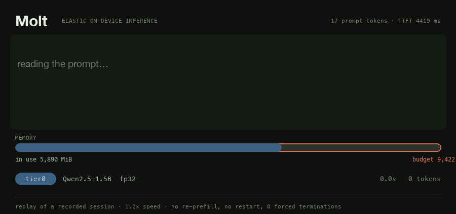

# Molt

**Moving a generation to a smaller model, in the middle of a sentence, without
ever holding both models in memory.** Built on MLX on Apple silicon, and tested
against a jetsam-style per-process memory cap.



**[Paper draft](paper/)** · **[All results, including where molt loses](RESULTS.md)** ·
**[MLX mappers on Hugging Face](https://huggingface.co/NagaYu/molt-kv-projectors-qwen2.5)** ·
**[Measurements](https://huggingface.co/datasets/NagaYu/molt-benchmark-results)**

## Prior work first: what is not ours

- **The KV mapping is prior work.** Heo et al., *Cross-Model KV Cache Transfer in
  LLM Families: A Closed-Form Linear Mapping for Prefill Reuse*
  ([arXiv:2608.03893](https://arxiv.org/abs/2608.03893)), fit per-layer, per-head
  closed-form ridge maps between different-size models of one family. They strip
  RoPE before mapping and select the top-k source layers by R². Their transfer
  happens at the **prefill hand-off point**. molt v0.1 called its RoPE handling
  "the detail nobody can skip". That handling is the same as theirs, and the
  credit is theirs.
- **Cross-model KV sharing** between models that share an architecture and a
  foundation model is DroidSpeak
  ([arXiv:2411.02820](https://arxiv.org/abs/2411.02820)). It works at prefill
  time.
- Re-reading the transcript with the new model (re-prefill) is a standard
  baseline. Keeping the first tokens follows StreamingLLM's attention sinks.

**What molt claims, and only this:** the switch happens

1. **mid-decode**, between two tokens of one generation, with no retracted
   tokens;
2. **under memory exhaustion**, triggered by the app's headroom to its own
   per-process limit (`os_proc_available_memory` on iOS), before the limit is
   crossed;
3. **with the two models never co-resident**. On MLX this takes more than "free
   and load", and a test guarantees that the kernel-tracked peak footprint stays
   under the cap.

Whether simple ridge mapping mid-decode is already enough decides whether molt
has a claim at all. That is the paper's central question, measured against a
faithful reproduction of the method above (condition **C**). It is answered in
[RESULTS.md](RESULTS.md), including every case where the answer is "C is enough"
or "re-prefill is better".

<!-- results:begin -->
*See [RESULTS.md](RESULTS.md).*
<!-- results:end -->

## What freeing a model actually takes on MLX (measured)

1. After `del`, MLX keeps the buffers in its allocator cache and does not reuse
   them for differently sized arrays. "Drop the big model, load the small one"
   therefore holds both.
2. `mx.clear_cache()` right after `del` frees the memory only sometimes. A
   buffer returns to the cache only after the GPU has finished with it.
3. After `mx.synchronize()` and `clear_cache()`, the OS still reclaims the
   memory asynchronously.

`molt_mlx.footprint.release_and_wait` synchronises, clears, and polls
`phys_footprint` until the memory is really gone. The **ordered** schedule
does this before loading anything. All memory numbers are `phys_footprint`,
which is what jetsam checks. RSS barely sees Metal buffers: a 256 MiB MLX array
moves RSS by almost nothing.

## Repository

| Path | What | Self-test |
|---|---|---|
| `mlx/molt_mlx/` | MLX implementation: footprint probe and C watchdog (jetsam emulator), RoPE, KV cache I/O, Heo et al. mapper and closed-form fit, calibration data, decode loop, memory-ordered migration, metrics, energy (rootless), HF export | `python -m pytest mlx/tests --import-mode=importlib` (every module's `selftest()` and the peak-footprint guarantee) |
| `bench/` | fit/selection, experiments I (intrinsic), Q (quality), M (memory cap), judge scoring, analysis, human-eval kit, `powermetrics.sh` | `python -m bench.conditions`, `python -m bench.prompts --selftest` |
| `ios/` | Swift: `MoltCore` (probe, pressure monitor, planner, Memory Budget Test), `MoltMLX` + app (Xcode) | `cd ios && swift run MoltCoreSelfTest` |
| `paper/` | arXiv LaTeX. Every number is a macro generated from `bench/results` | `cd paper && tectonic main.tex` |
| `figures/paper/` | generated by `figures/make_paper_figures.py` | |
| `molt/`, `benchmarks/`, `docs/v0.1-README.md` | the v0.1 PyTorch prototype, kept for provenance; superseded | `pytest tests` |

## Run everything

```bash
pip install mlx==0.31.2 mlx-lm==0.31.3 numpy scipy matplotlib huggingface_hub pyarrow datasets pytest
python -m pytest mlx/tests --import-mode=importlib
python -m bench.prompts                       # writes bench/prompts.json (committed)
nohup python -m bench.run_all > bench/results/run_all.log 2>&1 &
python -m bench.make_results_md               # RESULTS.md + the block above
cd paper && tectonic main.tex
```

## What is measured and what is not

| | Status |
|---|---|
| MLX implementation, Mac (M2), jetsam emulation by external watchdog | measured |
| iPhone: Memory Budget Test, Instruments, kills on ≥ 3 device generations | **pending**: no device attached, Xcode license not accepted on the build machine ([ios/README.md](ios/README.md)) |
| Energy | CPU per process and GPU system-wide, measured rootless; `powermetrics` cross-check **pending** (needs sudo) |
| Human ratings of the seam | **pending**: protocol and kit in `bench/human_eval/` |

## License

MIT
